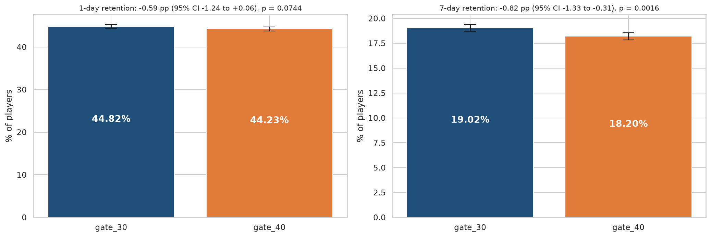
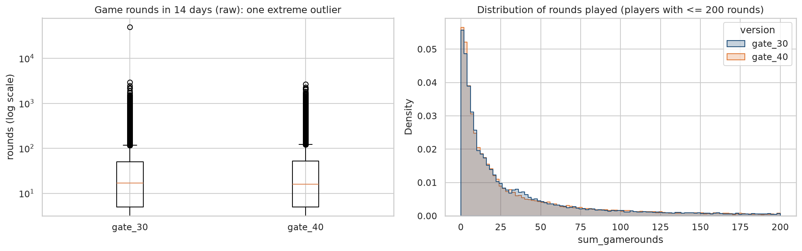
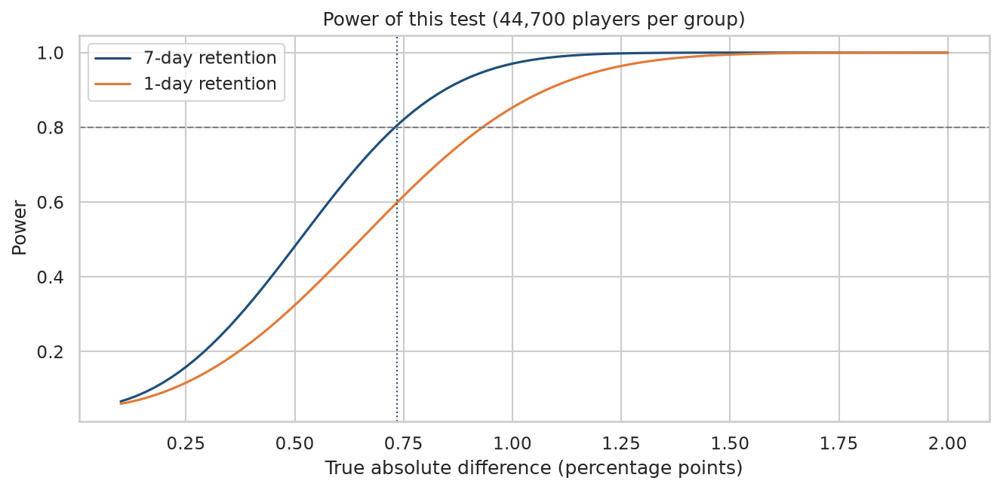
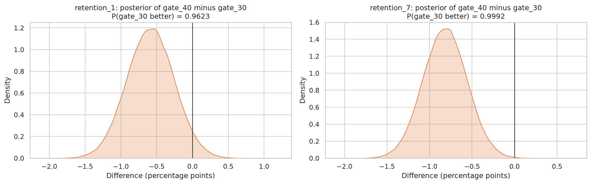
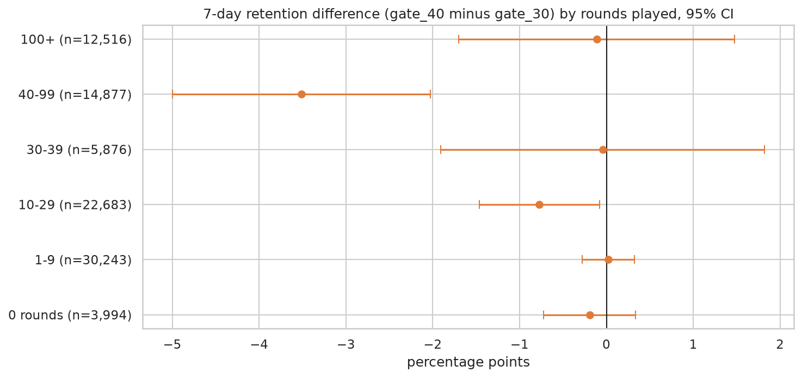

# A/B Test Analysis: Should Cookie Cats Move Its First Gate?

**A complete experiment readout on 90,189 players: sanity checks, power, frequentist and Bayesian tests, segment checks and a one-page decision memo.**

*Anthony Adusei-Poku · MSc Data Science, University of East London (2025)*

   

<p align="center"></p>

## TL;DR

* **Decision: do not ship.** Moving the first gate from level 30 to level 40 **cut 7-day retention from 19.02% to 18.20%**, a drop of **0.82 percentage points (95% CI -1.33 to -0.31, p = 0.0016)**, or 4.3% in relative terms.
* The result is consistent across a **z-test, a 10,000-shuffle permutation test (p = 0.0017) and a Bayesian analysis (99.9% probability that gate 30 is better)**.
* The test had **80% power to detect a 0.74 pp change** in 7-day retention, so it was large enough.
* 1-day retention (-0.59 pp, p = 0.074) and rounds played did not change significantly: the damage appears after day one.
* **Sanity checks found two real data issues**: a **sample ratio mismatch** (49.6% / 50.4% split, p = 0.009) and a player with **49,854 rounds in 14 days** (a likely bot). Both are reported and handled, not hidden.
* Read the **[one-page decision memo](docs/decision_memo.md)**.

## 1. Business question

In Cookie Cats, a mobile puzzle game by Tactile Entertainment, players hit "gates" that make them wait or pay to
continue. The team randomly assigned new players to the current gate at level 30 (`gate_30`, control) or a gate at
level 40 (`gate_40`). *Does the later gate keep players around longer?*

| Role | Metric |
|---|---|
| Primary | 7-day retention (played 7 days after install) |
| Secondary | 1-day retention |
| Guardrail | Game rounds played in the first 14 days |

## 2. Data

90,189 players with `userid`, `version`, `sum_gamerounds`, `retention_1` and `retention_7`. The data was released
through a [DataCamp project](https://www.datacamp.com/projects/184) and is mirrored on
[Kaggle](https://www.kaggle.com/datasets/yufengsui/mobile-games-ab-testing). No explicit licence is published, so
the data is not committed; `src/download_data.py` downloads a public mirror and verifies its checksum.

## 3. Method

1. **Sanity checks:** duplicates and missing values (none), **sample ratio mismatch** (chi-square vs the planned 50/50), outliers in the guardrail metric.
2. **Power and MDE:** minimum detectable effect at 80% power and alpha 0.05 for the achieved sample size, plus a power curve.
3. **Frequentist tests:** two-proportion z-tests with Wald 95% confidence intervals; a **permutation test** for the primary metric; Mann-Whitney U and a bootstrap CI for rounds played.
4. **Bayesian analysis:** Beta-Binomial model with uniform priors; probability each variant is better and the **expected loss** of each choice.
5. **Segment checks:** effects by engagement band, with **Holm correction** for multiple comparisons and an explicit warning that the bands are measured after assignment.
6. The statistics helpers in [`src/abtest.py`](src/abtest.py) are unit-tested against statsmodels ([`tests/`](tests/)).

## 4. Results

### Sanity checks

| Check | Result |
|---|---|
| Group sizes | gate_30: 44,700 · gate_40: 45,489 (49.56% / 50.44%) |
| Sample ratio mismatch | **chi2 = 6.90, p = 0.0086: fails at the 1% level** |
| Duplicates / missing | none |
| Players who never played a round | 4.4% (similar in both groups) |
| Largest rounds value | **49,854** (next highest 2,961): excluded from the rounds metric only |

The mismatch is small but more than chance usually produces, so it may point to an assignment or logging problem.
The data has no timestamps or platform fields to diagnose it; the memo asks engineering to investigate.

<p align="center"></p>

### Power

With 44,700 players per group, the test could detect a **0.74 pp** change in 7-day retention (3.9% relative) and a
**0.93 pp** change in 1-day retention with 80% power. Detecting a 0.5 pp change would have needed 95,737 players per group.

<p align="center"></p>

### Main results

| Metric | gate_30 | gate_40 | Difference (pp) | 95% CI (pp) | Relative | p-value |
|---|---:|---:|---:|---:|---:|---:|
| **7-day retention** | **19.02%** | **18.20%** | **-0.82** | **-1.33 to -0.31** | **-4.3%** | **0.0016** |
| 1-day retention | 44.82% | 44.23% | -0.59 | -1.24 to +0.06 | -1.3% | 0.074 |

* **Permutation test** (7-day): 17 of 10,000 label shuffles were as extreme as the observed difference, p = 0.0017.
* **Rounds played** (outlier removed): mean 51.34 vs 51.30 (difference -0.04, bootstrap 95% CI -1.36 to +1.27); median 17 vs 16; Mann-Whitney p = 0.051. No meaningful change.

### Bayesian view

| Metric | P(gate_30 better) | Expected loss if we pick gate_40 | Expected loss if we pick gate_30 | 95% credible interval (gate_40 minus gate_30) |
|---|---:|---:|---:|---:|
| 7-day retention | **0.9992** | 0.82 pp | 0.0001 pp | -1.33 to -0.31 pp |
| 1-day retention | 0.9623 | 0.59 pp | 0.005 pp | -1.24 to +0.06 pp |

<p align="center"></p>

### Segment checks (exploratory)

| Rounds played | Players | 7-day retention gate_30 | gate_40 | Difference (pp) | Holm-adjusted p |
|---|---:|---:|---:|---:|---:|
| 0 | 3,994 | 0.83% | 0.63% | -0.19 | 1.00 |
| 1 to 9 | 30,243 | 1.81% | 1.82% | +0.02 | 1.00 |
| 10 to 29 | 22,683 | 8.11% | 7.34% | -0.77 | 0.15 |
| 30 to 39 | 5,876 | 15.73% | 15.69% | -0.04 | 1.00 |
| **40 to 99** | **14,877** | **32.90%** | **29.39%** | **-3.51** | **< 0.001** |
| 100+ | 12,516 | 71.14% | 71.03% | -0.11 | 1.00 |

The drop is concentrated among players who reached 40 to 99 rounds, which is where gate_40 players meet their first
gate. Because rounds played happens after assignment (and can be changed by the gate), this is a lead for the game
designers, not a causal subgroup effect.

<p align="center"></p>

## 5. Decision

**Keep the gate at level 30.** Moving it costs about 820 week-one players per 100,000 installs, with no offsetting
gain in early retention or engagement. Fix or explain the sample ratio mismatch before the next gate test, and
consider testing an earlier gate with gate revenue as a co-primary metric. Full reasoning: [decision memo](docs/decision_memo.md).

## 6. Limitations
* The sample ratio mismatch means assignment may not have been perfectly random; the data cannot show why.
* No revenue or in-app purchase data, so the trade-off between retention and gate monetisation cannot be measured.
* No install dates, so novelty effects or day-of-week patterns cannot be checked.
* Segment results condition on a post-assignment variable and are exploratory only.

## 7. How to run

```bash
git clone <this-repo> && cd ab-test-analysis
python -m venv .venv && source .venv/bin/activate
pip install -r requirements.txt
python src/download_data.py
jupyter nbconvert --to notebook --execute --inplace notebooks/ab_test_analysis.ipynb   # ~30 seconds
pytest -q
```

## Repository structure
```
ab-test-analysis/
├── notebooks/
│   ├── ab_test_analysis.ipynb   # full analysis, executed with outputs
│   ├── ab_test_analysis.html    # static HTML export
│   └── ab_test_analysis.py      # same code as a plain Python script
├── src/
│   ├── download_data.py         # downloads and checksums the data
│   └── abtest.py                # SRM, z-test, MDE, sample size, power, Beta-Binomial
├── tests/test_abtest.py         # checks against statsmodels and known cases
├── docs/decision_memo.md        # one-page recommendation for stakeholders
├── figures/                     # charts (PNG)
├── results/                     # test results, segments, summary stats
└── requirements.txt
```

## Skills shown
Experiment design and readout · sample ratio mismatch and data quality checks · hypothesis testing and confidence
intervals · power analysis · permutation and bootstrap methods · Bayesian A/B testing · multiple-testing correction ·
writing a clear recommendation for non-technical stakeholders.
